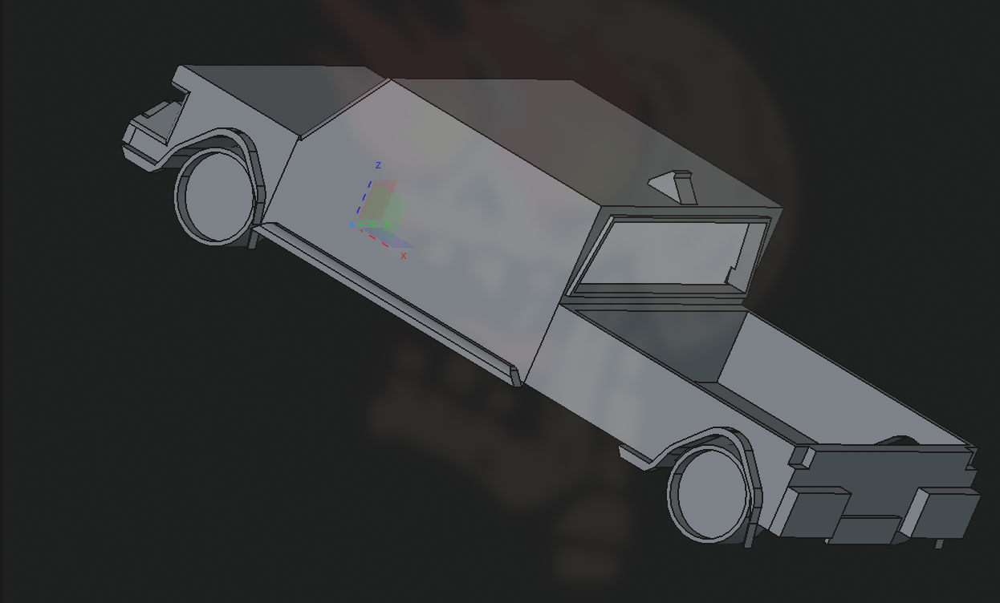
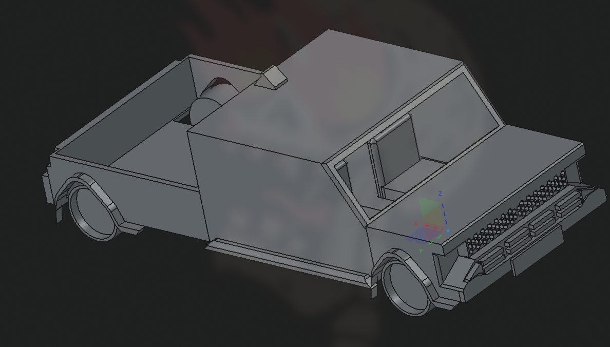

# Toyota Hilux – My First FreeCAD Model

My first-ever attempt at 3D modelling using **FreeCAD**, and I decided to model a Toyota Hilux.

Does it look like a proper Toyota Hilux? Kind of.  
Does it look miserable? Absolutely. 💀  
But hey, it's my first time using FreeCAD, so I'll take it as a win.

## 📸 Model Preview

## 🛠️ About the Project

This project was my attempt at recreating a **Toyota Hilux pickup truck** from scratch in FreeCAD.

I had around **one week** to work on this, while also learning how FreeCAD works. So most of the project involved experimenting, figuring out the tools, making mistakes, and occasionally wondering why something that worked five minutes ago suddenly stopped working.

The final model is far from perfect, but I managed to put together something that at least resembles a pickup truck.

### What I Managed to Model

- Basic truck body and cabin
- Pickup bed at the rear
- Wheels and wheel arches
- Front grille and bumper details
- Windshield and window outlines
- A few additional exterior details

## 💀 Problems I Encountered

### 1. The Mysterious Disappearing Model

For some reason, I couldn't get the cab windows to work properly.

Whenever I tried using **Pocket** or **Pad** to create the window openings, the entire model would simply disappear.

I tried figuring out what was going wrong, but couldn't get it working within the available time.

So the windows ended up being a little... questionable.

### 2. Learning FreeCAD From Scratch

This was literally my first time using FreeCAD, so even basic operations took longer than expected.

A good chunk of the time went into understanding sketches, constraints, pads, pockets, and how different operations affect the model.

### 3. The One-Week Time Limit

I only had a week to complete the project, which meant I couldn't spend forever fixing every little detail.

Some parts are rough, some proportions are off, and a few things definitely could have been done better.

But considering the time limit and my complete lack of prior FreeCAD experience, I'm happy I managed to finish something.

## 📚 What I Learned

- Navigating and working with FreeCAD
- Creating and editing sketches
- Using basic Part Design operations
- Building more complex shapes from simpler geometry
- Understanding how easily one operation can break an entire model
- Working within a deadline while learning an unfamiliar tool

## 🚀 Final Thoughts

Is this a good Toyota Hilux model? **Not really.**

Is it a decent first attempt at using FreeCAD? **I'd say so.**

There's definitely a lot of room for improvement, especially with the windows, proportions, and overall detailing.

But the goal wasn't to create a professional-grade model. It was to learn FreeCAD, experiment with 3D modelling, and complete something within a week.

And I did exactly that.

**Version 1: A slightly cursed Toyota Hilux.** 🚙

*Made with FreeCAD, trial and error, and a fair amount of confusion.*
